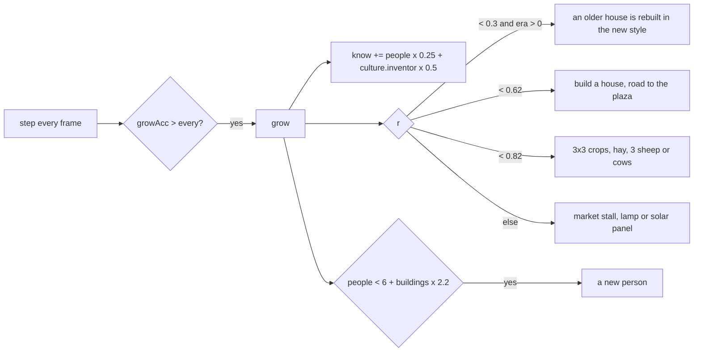
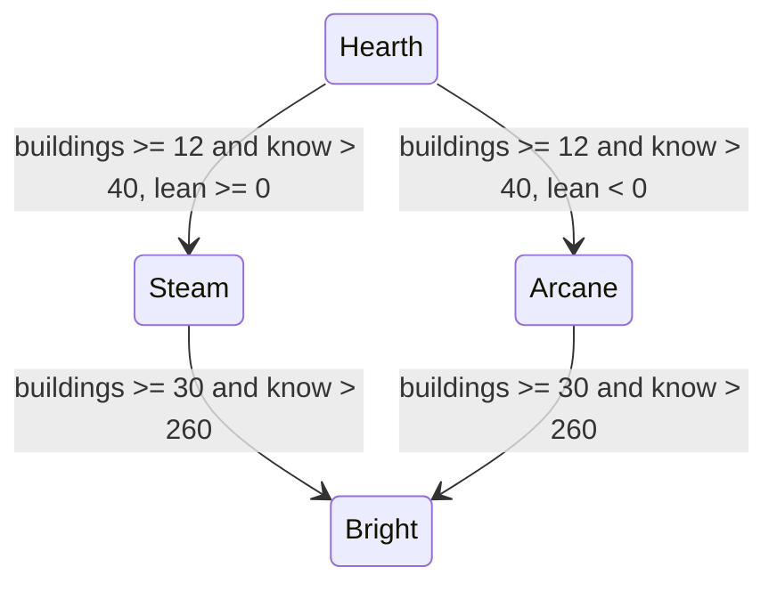
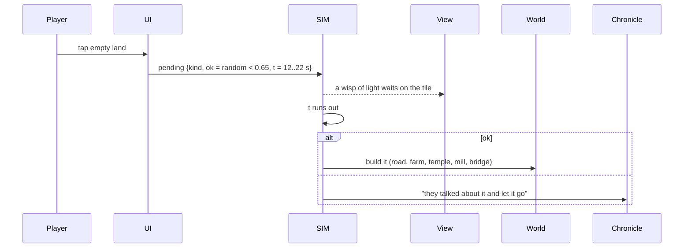
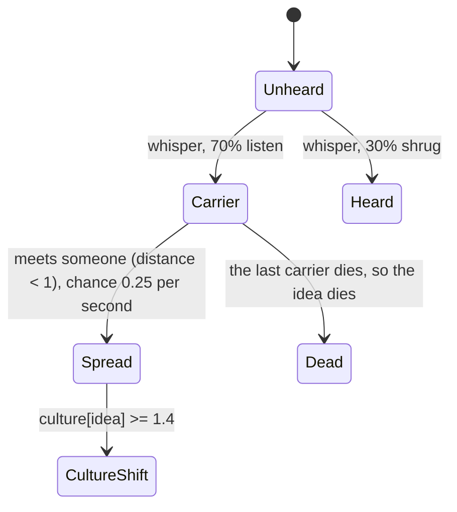
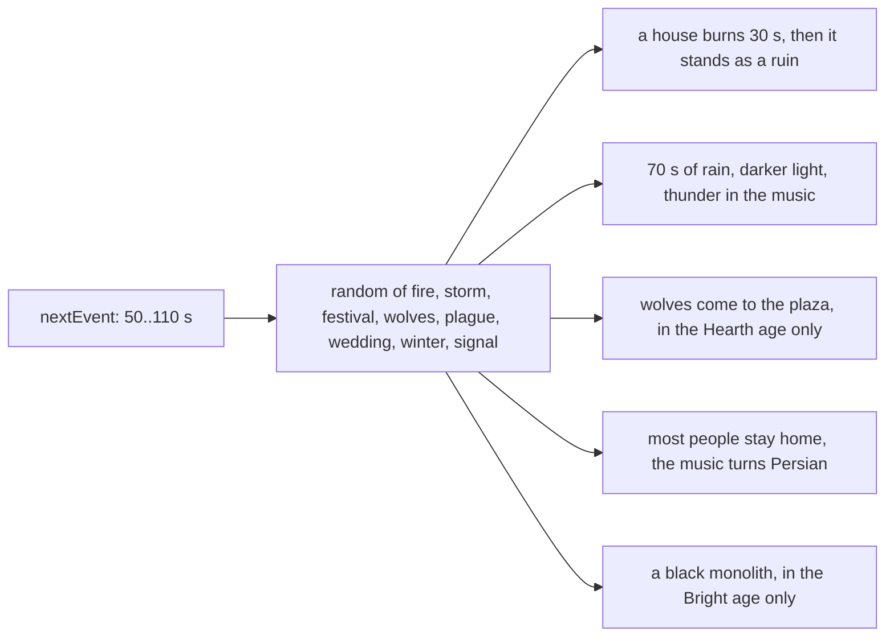

# How Embers of Now works

Everything lives in `index.html`, in sections marked `ART`, `WORLD`, `SIM`, `VIEW`, `SOUND`, `UI` and `SAVE`. The SIM section draws nothing, so it can later move into an engine shared with Dungeon Town.

## Growth of a settlement

`every` is 4 s while there are under 8 buildings and 9 s after that (1 s with `?fast=1`). `findSpot` looks at a radius of 1.5 + sqrt(buildings) x 1.2 + up to 2 tiles around the plaza, so the town spreads in rings. `road()` walks a staggered path to the plaza and each pass wears the road (`road` 1 is dirt, 2 and above are cobbles). A road may cross water as a bridge, but only 5 bridges are allowed, so the river is never paved over.

Worked example: at minute one there are 9 buildings. A grow roll of r = 0.7 makes a farm at (25, 19), so nine tiles turn to wheat, a haystack lands at (27, 19) and three sheep get that farm as their home.

## Eras and branches

`lean = culture.inventor - culture.priest + (hash(seed) - 0.5) x 3`, so the seed sets the fate but whispers can tip it (`leanNow()`). Once `know > 18` in the Hearth age the well shows the lean, with smoke puffs for steam and violet sparks for the arcane. Each era has its own building kinds (`KINDS`), vehicles (carts, cars, gliders), road surface and music style.

## Whisper to a place

It's allowed once every `WHISPER_GAP` = 1800 s of world time (`whisperAt`).

## Whisper to a person, and how an idea spreads

A whisper that's heard adds 0.3 to `culture[idea]` and each new carrier adds 0.2, so about six carriers shift the culture once (`cultureShift`). Example: Wren becomes an inventor and meets Bel and Sol at the well, which takes the culture to 0.7. Three more meetings bring it to 1.3, a fourth to 1.5, and then know goes up by 60, which brings the next era closer and leans the town to steam.

## The odds

The first event comes after 25 s.

## A being's life
People age one year every 20 s and die at a `life` of 55 to 85, which adds a chronicle line (and the idea dies if they were its last carrier). A funeral follows: the first death picks a graveyard spot (`W.yard`), each death sets a stone (`grave0` or `grave1`) in its 3 x 3 tiles, and up to 10 people walk there. They walk to a random building's door 60% of the time, otherwise around the plaza, or to the square during a festival or wedding. Animals graze around their farm and wolves keep to the forest, leaving the map in the Bright age.

## Catch-up on return
`load()` reads `civilization.r4opus.v1` (version 1) and runs `step(4 s)` up to min(away / 6, 900) times without walking anyone (capped at 6 hours away), then writes "While you were away, N new roofs rose."
