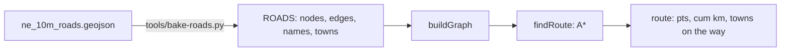
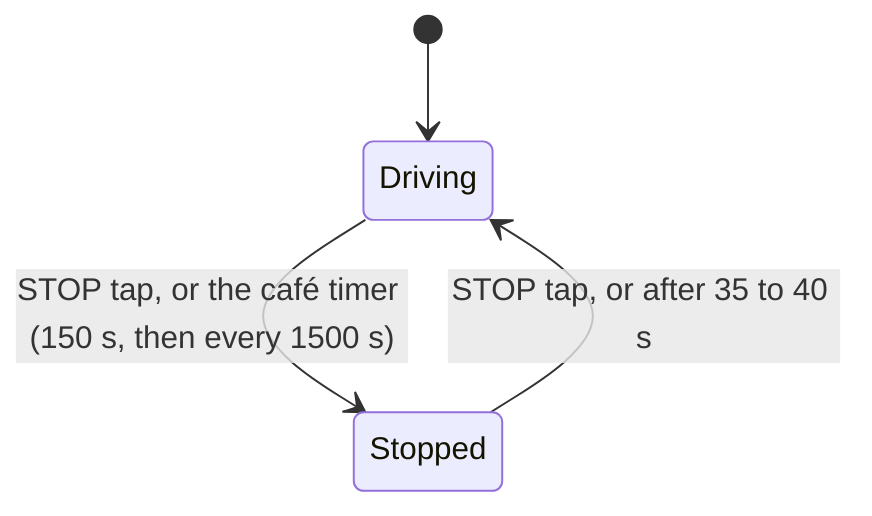

# How Drive works (r4-opus)

Everything is in `index.html` (`<script id="main">`); the names below are as they appear in the code.

## Route finding on the baked road graph

The bake keeps European segments inside Spain's box, snaps every vertex to a 0.03 degree grid, links consecutive vertices, then merges chains of degree-two nodes (except within 0.12 degrees of a town), which gives 926 nodes and 1,107 edges in about 37 KB. `findRoute` runs A* with the great-circle distance as the heuristic and adds the hop from the city centre to its nearest node at each end. `route.towns` lists every town within 14 km of the route with the km where it passes. Tested by `node --test tools/route.test.mjs`.

Worked example: Madrid to Valencia gives 392 km (the real road is about 355 km; the coarse 1:10m shapes add some), passing Cuenca and Requena, so the first sign says "Requena" and "Valencia" with their kilometres.

## Driving model

`PACES` holds five steps: 90, 110 and 120 km/h at real time, then 120 km/h at x8 and x60. `save.km` grows by `kmh / 3600 * dt * x`, so at x1 an hour of driving is 120 km. The road scrolls by `unitsPerKm * 7`, capped at 2.2 times so compressed time looks fast but never frantic. Indicators set `car.blink` for 3.2 s and move `car.lane` after 1.2 s; the car also passes on its own when a slower car is less than 2,500 units ahead in its lane (chance 0.5 per second), using a free lane. Reaching the end of the leg counts a delivery and starts the next leg of `LOOP`. Progress is saved every 10 s in `drive.r4.save` (v1), and time away keeps driving at 100 km/h for up to six hours.

## Traffic
A jam (`jamT`) starts 240 s into a session and then every 540 s, and lasts 30 s: our target speed drops to 35 km/h and every car crawls at 30 to 38 km/h with its brake lights glowing. `?jam=1` holds it.

Seven cars at a time from `MODELS` (six cars and two lorries) in random lanes at 80 to 130 km/h. A car never closes within 900 units of the one ahead in its lane or of us; cars that fall behind or run far ahead are replaced far ahead. At night or in bad weather their tail lights glow.

## Camera director
`CAMS` cycles cockpit 45 s, chase 22 s, cockpit 40 s, side 16 s, cockpit 50 s, chase 20 s, with a fade between. A stop always shows the side view with the driver outside. `?cam=` holds one view.

## Light and weather
`sunPos(now, lat, lon)` at the car's position gives the sun's altitude, and `palette(alt)` blends six keys (from -18 to 35 degrees) into the sky, fog, road and an ambient colour that multiplies every prop (`tinted`), so night is night everywhere. The day and night skylines cross-fade by `pal.night`. Weather comes from Open-Meteo every 10 minutes (`wx:open-meteo:<lat>,<lon>`, kept 30 minutes); WMO codes map to rain, snow, fog or clear, and offline it stays clear. Rain draws streaks, drops on the windscreen and a wiper every 2.4 s; fog washes the scene.

## The radio
```mermaid
sequenceDiagram
  participant P as Player
  participant A as audioStart (click)
  participant L as LOFI
  P->>A: first tap (click, never pointerdown)
  A->>L: LOFI.song(seed, moodNow())
  L-->>A: sheet, played by new LOFI.Player
  Note over A: audioTick schedules 1.5 s ahead; a new song 8 s before the end
  P->>A: FM button
  A->>L: switch between the local style and the mixtape
```
The local station picks a style from where the car is (`regionStyle`: Meseta and Huerta play flamenco, Ebro plays rioja, the Catalan coast plays bossa), and the mixtape plays the plain lo-fi with `night` and `rain` from the real light and weather. A filtered sawtooth hums under it as the engine, pitched by speed.

## Deliveries and easter eggs
Each leg carries one of `PARCELS` (shown in the HUD), and `save.delivered` counts them. The cat sits by the car at stops after an odd number of deliveries, or at random.
