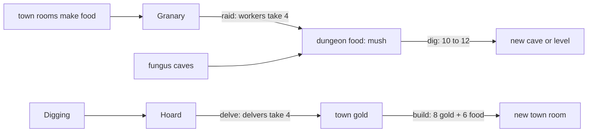
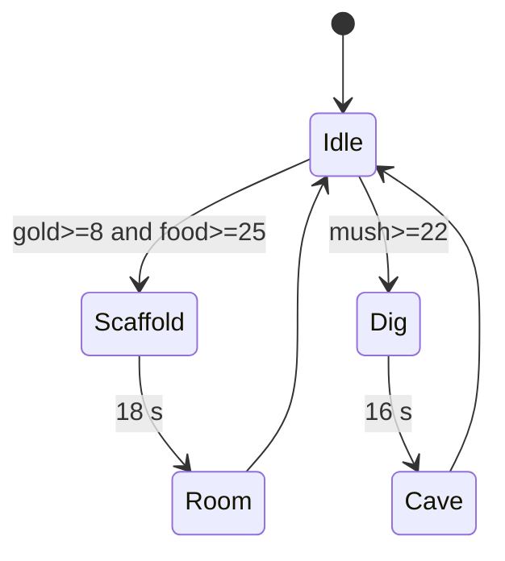
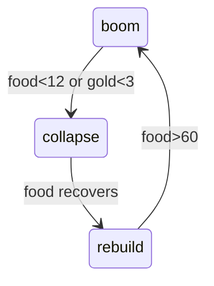
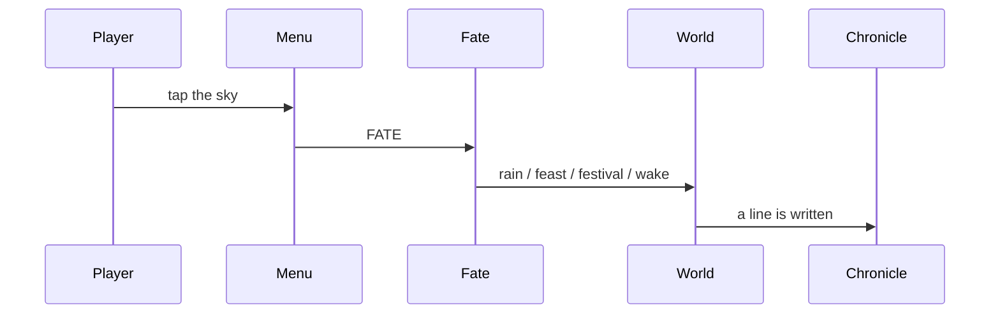
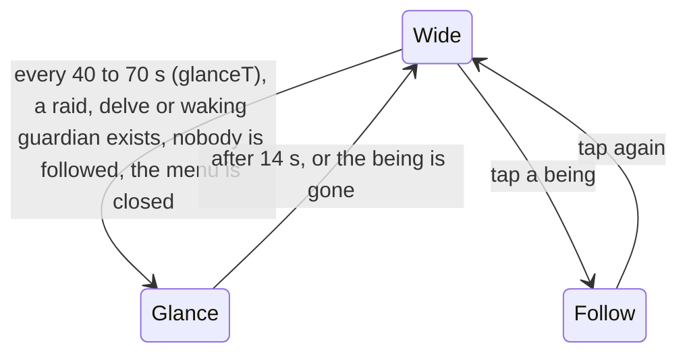

# Dungeon Town (r4-opus): how the systems work

Everything lives in `index.html`. The numbers below are named as in the code.

## The gold-for-food loop

`simTick(dt)`: `food += dt*(0.05*columns*season*(rain?1.4:1) - 0.012*townRooms)`, `mush += dt*(0.025*fungusCells - 0.008*caveCells)`, `hoard += dt*0.012*levels`. Above 40 gold the town spends 0.006 per room per second on finery (decadence). `pressures()` every 9 to 17 s: if `mush < 25` the workers raid (70%), else if `gold < 20` delvers go down (70%). Each raider has a 15% chance to be slain by the guards; each delver dies with chance `0.18 + 0.04*levels` (+0.5 while the guardian is awake) and gets a grave.

Worked example: the granary holds 30 food, mush is 18. A raid of two goblins climbs the ladder, each takes 4 (granary 22) and carries a sack down (mush 28). Mush is now above 22, so the deepest level digs one more cave (mush 18, 16 s of digging). The hoard grows, the vault is at 5 gold, so the next pressure sends two delvers who bring 8 gold back; with 13 gold and 22 food... the town waits until food reaches 25, then builds.

## Growth room by room and the ground line

Only one thing builds at a time. The town adds a floor to its lowest column (scaffolding shows while it goes up); the dungeon widens its deepest level from the right, then opens a new level. Both stop at `maxRows() = floor((H-30)/56)`. The ground line `G` eases towards `groundTarget() = (H + 56*(townHeight+1) - 56*levels)/2`, so a taller town pushes the dungeon down and a deeper dungeon pushes the town up.

## The cycle and the ages

When food stays at zero the top room of the tallest house is left to ruin (2% a second); when mush stays at zero the deepest cave is abandoned. Each time the town falls back to one room per column with food under 5, a new age begins (`w.age`). At the seventh age (`w.ended`) the city reaches its point of no return: it is added to `dungeontown.r4.lost`, a card tells the end, and a new town is founded in the next city. Picking another city by hand also marks the old one as lost.

## Beings

Each being has a side, a sprite, a job (`folk`, `animal`, `delve`, `raid`, `worker`, `beast`, `lurker`, `guardian`), a name, a story list and a speech icon. They walk along their floor, and change level only by the timber ladder on the right edge (`goTo` builds a path: walk to the ladder, climb, walk). A town floor counts as reachable (`reachable(ci, k)`) only when every house between it and the ladder has that floor too, so nobody walks on air. The guardian wakes on its own about every five minutes (4% per pressure check) and once 75 s after the page opens, so the rare event is seen early; while awake it glows red and delves are far more deadly. Icons show hunger, fear, gold, love, sleep. The cast is seeded: one worker, one lurker and one beast species per run, and a dragon guardian asleep on the hoard at the bottom.

## Nudges of fate (once every 30 minutes)

Rain: 3 minutes of rain, +10 food, the grotto floods. Feast: -20 food, +10 mush (scraps down the river), everyone shows love. Festival: lanterns for 4 minutes, -6 gold, 4 delvers go down. Wake: the guardian wakes for a minute (delves turn deadly), +30 hoard and a house loses its top floor.

## Catch-up on return

`catchUp()` runs `simTick` in 20 s steps over the time away (up to 6 hours) with abstract delves and raids, then shows the last chronicle lines in a card that fades after 11 s.

## The idle camera

A glance zooms 2x on a wide screen (1.6x on a phone) and follows the chosen being without any text; a follow zooms 3x and shows the name. `?cam=` holds the camera and turns the glance off. Worked example: 45 s after the page opens two goblins are climbing the ladder, so the camera eases in on one of them as it reaches the granary, shows its love icon as it takes a sack, and pulls back out as it climbs down.
