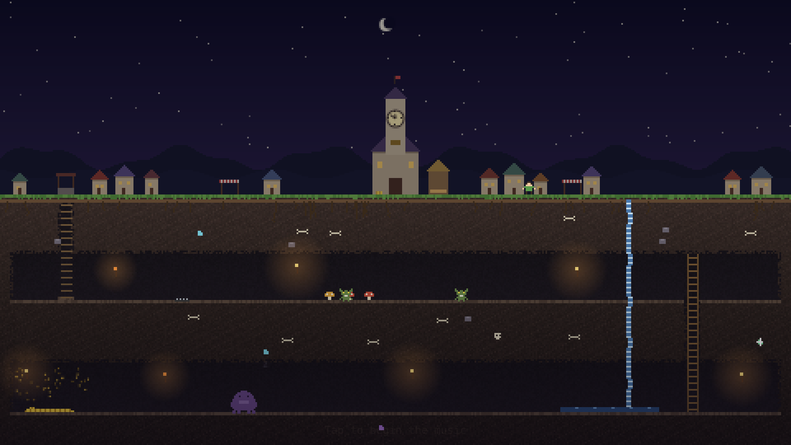
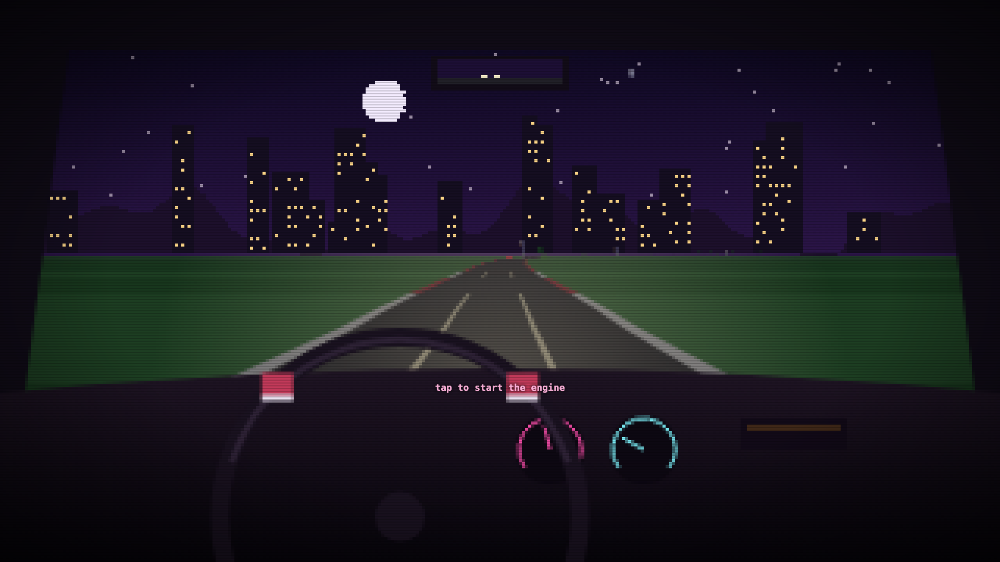
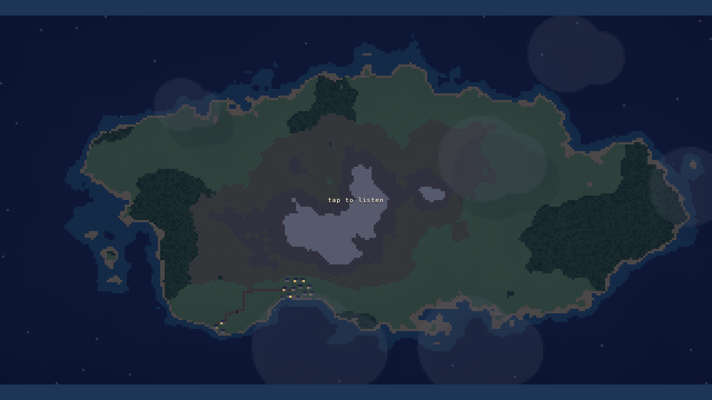
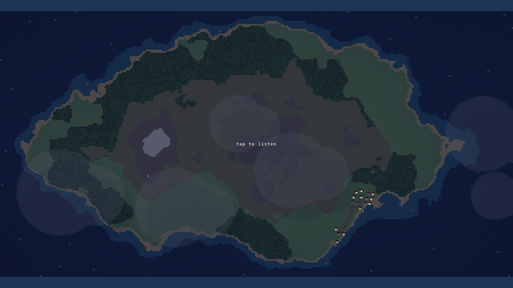

# First gauntlet: results

This was held on 2026-11-26. Three Opus agents each built a different idea from `idletoys/`, following `GAUNTLET.md`. They started at 23:43 with 15 minutes. Partway through, the target screen changed from a 390 x 844 phone to a 16:9 desktop at 1920 x 1080, so every agent got five extra minutes, which made the deadline 00:03. None of them needed it. Civilization finished at 23:49, dungeon at 23:50 and drive at 23:51.

The entries are in `dungeon/gauntlet/opus/`, `civilization/gauntlet/opus/` and `drive/gauntlet/opus/`.

## How they were judged

Each entry was served from `idletoys/` with `python3 -m http.server 8090` and photographed in headless Chrome at 1920 x 1080, after about 8 seconds and with nobody touching it. Civilization was photographed a second time after 90 seconds to see how it grows. Its second picture shows a different island, because a fresh browser profile gets a new seed.

Their code was also checked against the rules. I haven't heard the music, tapped any entry, tried offline mode or tested on a phone, so the Music and Steering scores come from the code and the agents' own reports and should be checked by ear and by hand.

## Rule checks

All three pass every rule I could check. Each folder holds `index.html`, `manifest.webmanifest`, `sw.js`, `icon.svg` and `NOTES.md`. The page links the manifest and registers the service worker, and nothing calls outside the page. No console messages appeared in 30 seconds without input. The only `innerHTML` in any entry is the dungeon's mute button, which sets fixed text, so it's safe.

Every entry copied the Clockscapes `<script id="lofi">` music generator and says so in its NOTES.md.

## Scores (1 to 5)

| | Dungeon | Civilization | Drive |
|---|---|---|---|
| Artfulness | 5 | 3 | 4 |
| Polish | 4 | 2 | 4 |
| Idle | 4 | 3 | 4 |
| Steering | 4 | 4 | 3 |
| Music | 3 | 4 | 3 |
| Faithful | 5 | 3 | 4 |
| Room to grow | 4 | 3 | 4 |
| **Total** | **29** | **22** | **26** |

## 1. Dungeon Town (29)

This is the most complete picture of its idea. A night sky and a moon sit above a lit clock tower that shows the real time, and below the town are two cave floors with warm torch glows, goblins at work, a sleeping purple guardian on its gold, and a waterfall falling from the surface into an underground pool. It reads as one screen with a mood of its own.

Its weak spots are the "tap to hear the music" hint, which is almost invisible at the bottom, and the music, which its maker says came out as a fife over keys rather than dungeon synth.

## 2. Night Drive (26)

This has the strongest single mood of the three: a cockpit view at night, a glowing city skyline, a full moon, pink and teal gauges and a CRT overlay.

But the roadside grass is bright green at night, which breaks the mood, and two red squares sit on the steering wheel without reading as anything. With eight buttons it also comes the closest to letting the player control instead of steer.

## 3. Seedling, civilization (22)

The idea is good and the island itself is lovely. But the clouds are big, soft, see-through circles that clash with the pixel art and cover the land. After 90 seconds there was still a single village, so the first minute feels empty. The "tap to listen" hint was also still showing at 90 seconds, even though it should go after 6, so it may be stuck.

Its music idea is the best of the three: each seed picks a regional style from the generator.

## What to change next time

The agents' own attempts to open a browser or start a local server were blocked by the auto-mode permission check, and the Chrome extension wasn't connected. So all three were built without anyone seeing them run. The small bugs above are exactly what one look would have caught. Next time, start the shared server before the agents begin and tell them it is there.
