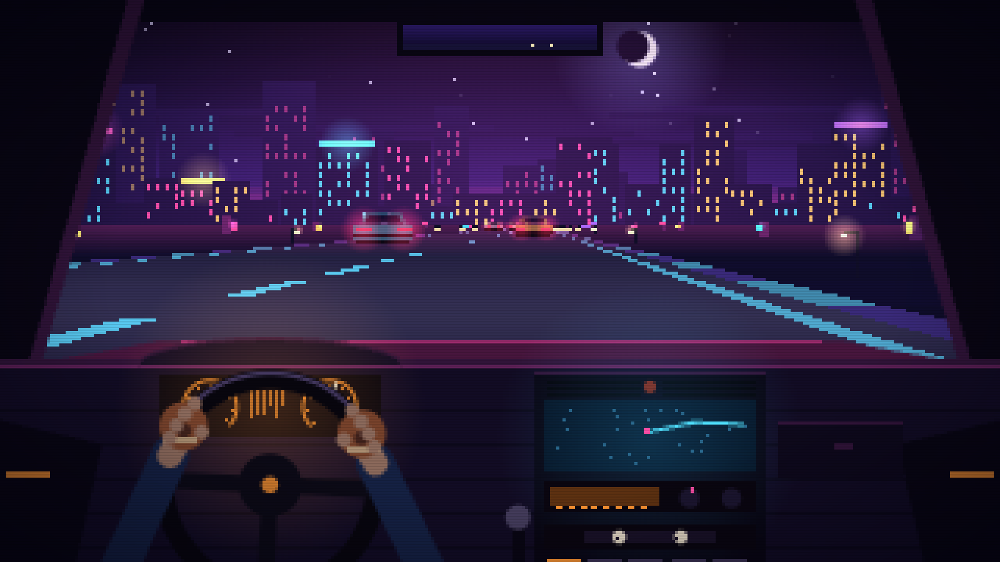
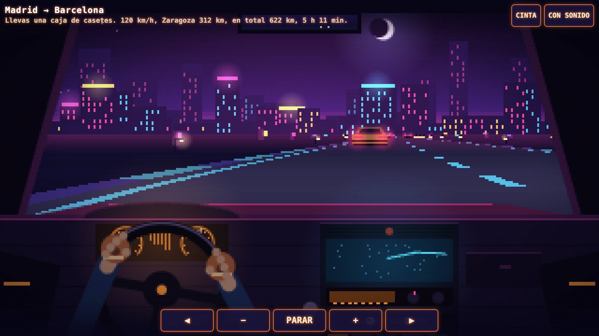
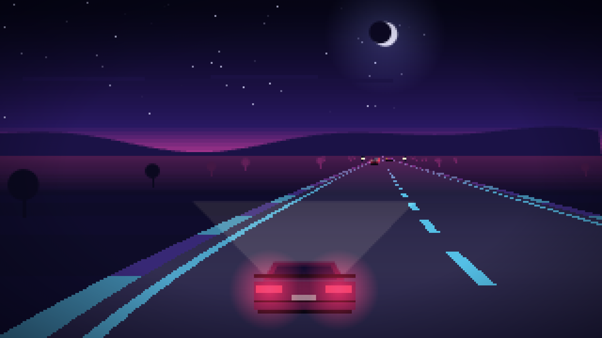
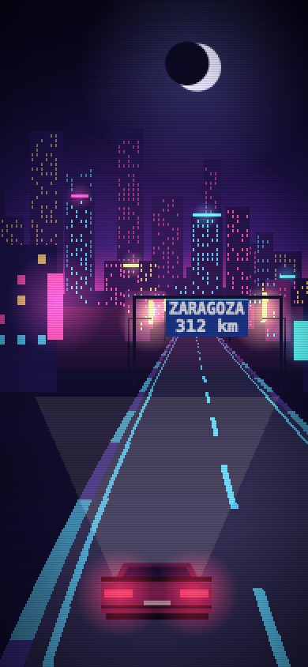
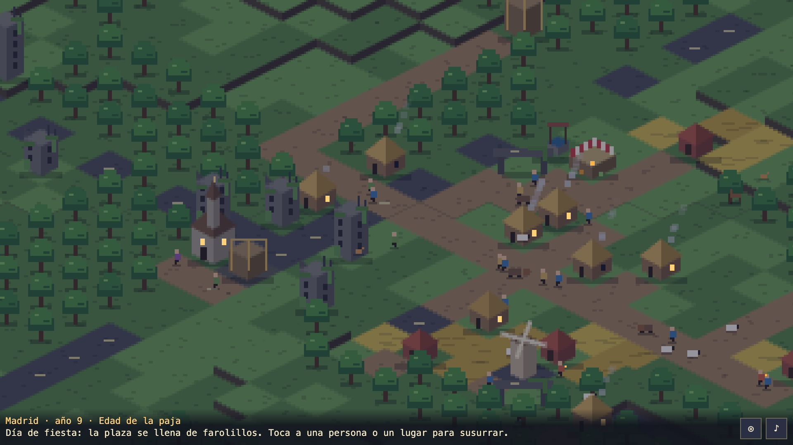
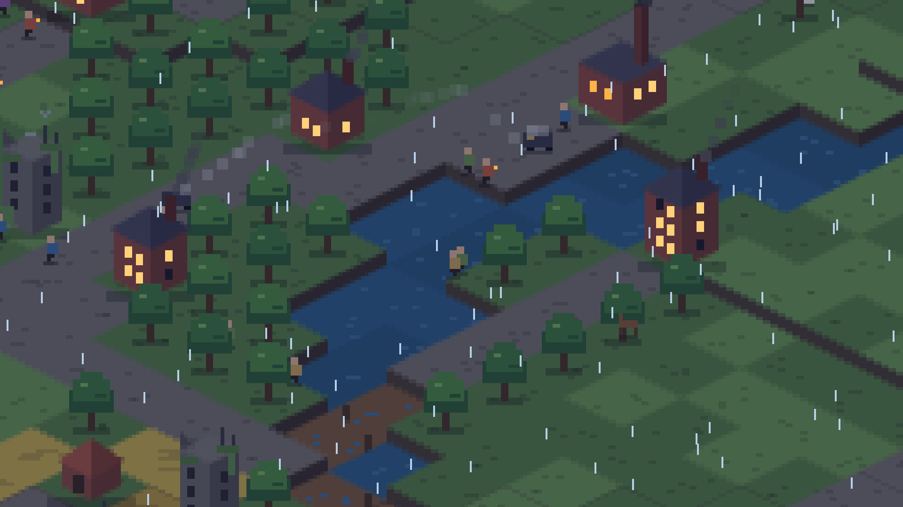
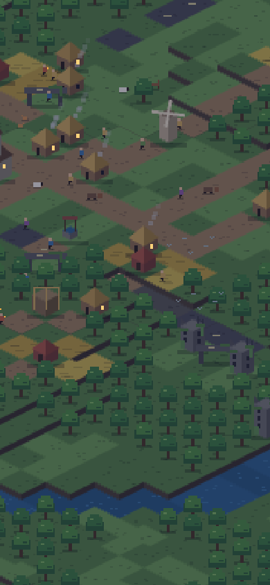
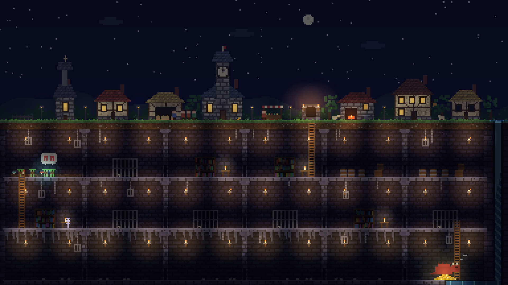
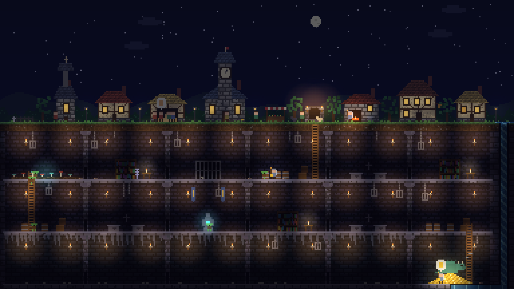
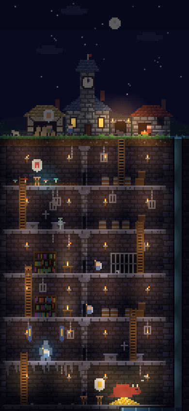

# Round two (r2): results

This round was held on 2026-11-27. Three Fable agents each built one idea, with entries in `<idea>/gauntlet/r2-fable/`. They started at **00:49** (Europe/Madrid) and had 15 minutes, so the end time was **01:04**.

What changed since round one: one server ran at `http://localhost:8090/` for the whole round, and contestants had a look tool, `idletoys/tools/look.sh`, with a rule to look at their entry at least twice. Before the start, a Fable probe agent ran the tool as a contestant would. It was allowed, it reported 0 errors, and it could see the screenshots.

## Notes during the round
- 00:58: dungeon finished and handed in. It looked twice with the look tool (errors: 0 both times). It reports that the tool's tap does not unlock audio, so its music was never heard.
- 00:58: civilization finished (it says about 00:59) and looked three times (errors: 0). It left scratch files in /tmp and did not open the inspiration pictures.
- 00:59: drive finished (it says about 01:00) and looked twice (errors: 0). All three handed in before the end time, so judging started early.
- 01:04: the 15-minute timer ran out. Nobody was still working.

## How they were judged

Each entry was run with the look tool at 390 x 844 and 1920 x 1080 (after 5 s, after 60 s, and after a tap in the middle), plus one 5-minute idle run at 1920 x 1080. The judge's browser is in Spanish, so the entries show their Spanish text. I can't hear the music or test on a real phone, so Music is judged from the code, and one sound problem below is inferred from the console rather than heard.

## Rule checks

All three pass. Each folder holds `index.html`, `manifest.webmanifest`, `sw.js`, `icon.svg` and `NOTES.md`, and every page links its manifest and registers its service worker. The only outside host anywhere is drive's weather call to `api.open-meteo.com`, which the rules allow, and none of the entries uses `innerHTML` at all. Nothing outside the three `r2-fable/` folders changed during the round (I checked file times in `idletoys/` and `clockscapes/`). The console showed 0 errors in all six runs.

There was one console warning, and it matters. At phone size, after the tap, dungeon and civilization log "The AudioContext was not allowed to start". Both start their sound on `pointerdown` (dungeon `index.html:3287`, civilization `index.html:3202`), and a touch's pointerdown doesn't count as a user gesture in Chrome. So on a phone the music probably needs a second tap. Drive starts its sound on `pointerup` and `click` (`index.html:3505`, with the comment "sound needs a finished tap"), and its log is empty.

## Scores (1 to 5)

| | Dungeon | Civilization | Drive |
|---|---|---|---|
| Artfulness | 5 | 4 | 5 |
| Polish | 4 | 4 | 5 |
| Idle | 4 | 5 | 4 |
| Steering | 4 | 4 | 4 |
| Music | 3 | 3 | 4 |
| Faithful | 3 | 4 | 4 |
| Room to grow | 4 | 4 | 4 |
| **Total** | **27** | **28** | **30** |

Round one's totals were 29, 22 and 26, so civilization and drive gained the most.

## 1. Night Courier, drive (30)

This is the most finished entry of either round. The cockpit has real gloved hands on the wheel, orange dials, a map screen and a cassette radio, under a neon skyline, which fixes round one's "hands as red squares". After a tap, the five buttons and two labels sit at the edges and fade, so it never turns into a control panel. Over 5 minutes the camera moved to the chase view by itself. On a phone it picks a portrait chase view with a gantry sign, "ZARAGOZA 312 km", which is the best phone layout of the round.

Against the brief, the cockpit, indicators, pace, stop, fading HUD, two radio modes, cameras switching by themselves, saving and real weather are all there. But the road graph is 28 cities typed from memory, not baked from real data. Only the night scene was ever seen, so day, dusk, rain and the driver outside are unchecked by anyone.

## 2. Civilization (28)

This is the biggest jump from round one. The world is now seen close: an isometric town of thatch huts, a windmill, a festival tent, fields and walking people, all among grey ruined towers that show "the ruins of now". In 5 minutes of idling the camera zoomed right in, rain fell, and brick houses with lit windows had replaced the huts, so the age change shows on screen. The caption after a tap explains the whispers in one line and then goes away. Round one's stuck hint and soft circles are gone.

The ground is flat tiles in plain colours, the forests repeat the same tree, and the agent says the roads still form a blob that its last fix didn't change on screen. It didn't open the inspiration pictures. It shows a real place picked by the player, two ages, close-up life, both whispers, two zoom levels and saving, so most of the brief is there. The terrain isn't the real map, though.

## 3. Dungeon (27)

It's the richest picture of the three: a stone church, half-timbered houses, a clock tower, a glowing forge, and three furnished dungeon floors with cells, bookshelves, hanging cages, torches and a red guardian on its hoard. On a phone it becomes a tall tower of six floors, and that layout is lovely. It's a clear step up from round one's empty dirt bands.

But the floors repeat the same brick and torch pattern, the beings are tiny against them, and after 5 minutes the only clear change is a bigger gold pile, which is close to the brief's "looks the same after ten minutes". There's no city picker, no real weather, no ages and no rare event confirmed on screen, so Faithful is lower. Follow, speech icons, the fate die, saving and the chronicle are built but weren't seen in the judge's runs.

## What to change next time

- **The look tool worked.** Every contestant looked at least twice, saw 0 errors and fixed what it saw. That is the main difference from round one.
- **The tool's tap should test sound properly.** Add a desktop click as well as the phone touch, and print the `AudioContext` state after each tap, so a contestant sees "sound: suspended on phone tap" instead of only a warning in the log.
- **The tool only ever sees night when the round is run at night.** Let it take a time override (for example `?hour=13`) and ask every entry to support one, so day scenes get looked at too.
- **One tap in the middle can't reach features at the edges.** The tool could also tap a list of points given on the command line.
- **Remind contestants to open the inspiration pictures.** Civilization skipped them to save time.
