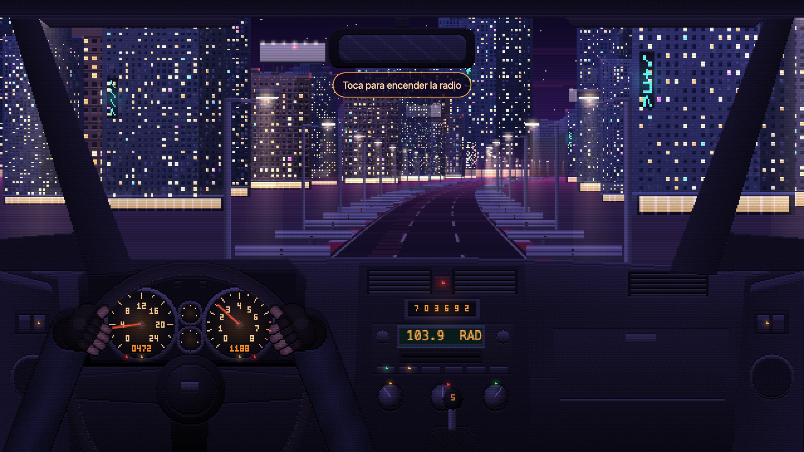
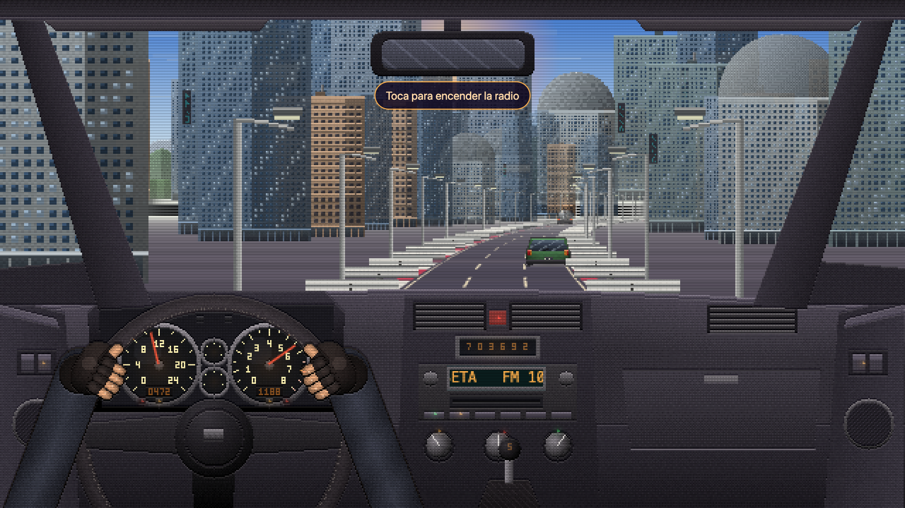
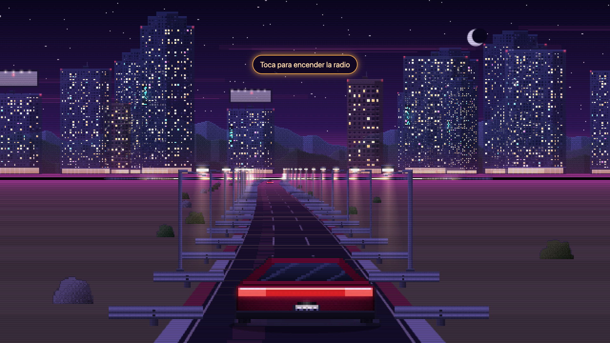
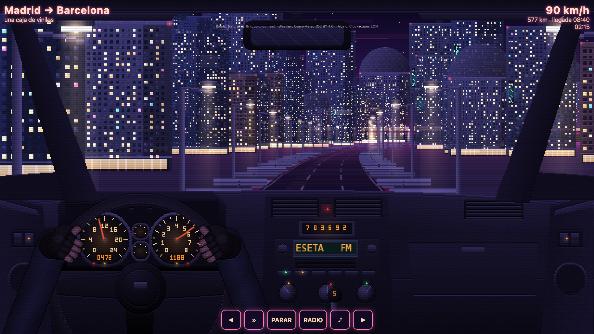
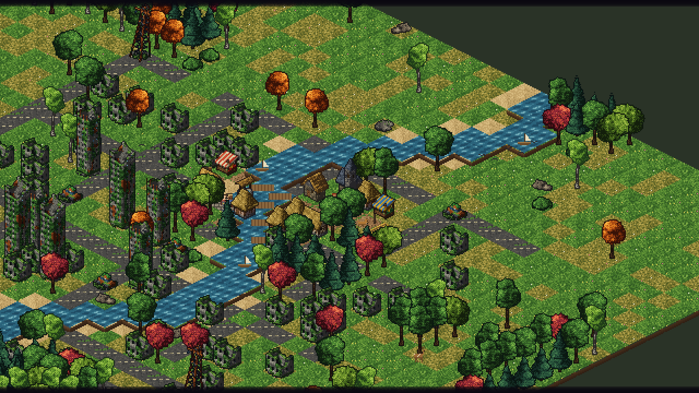
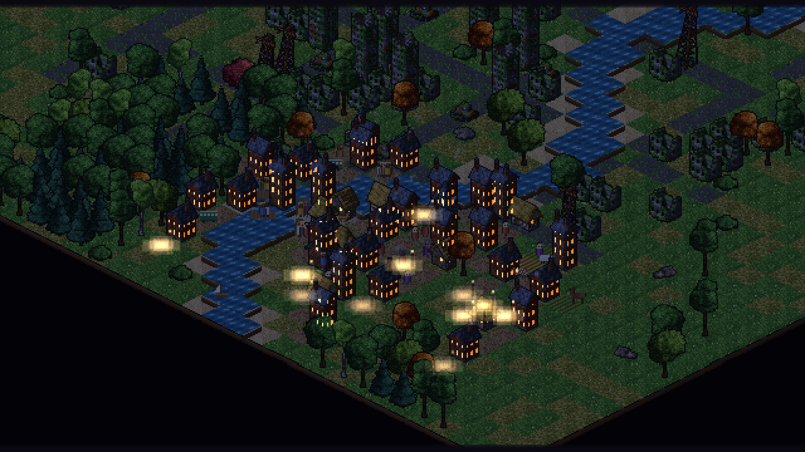
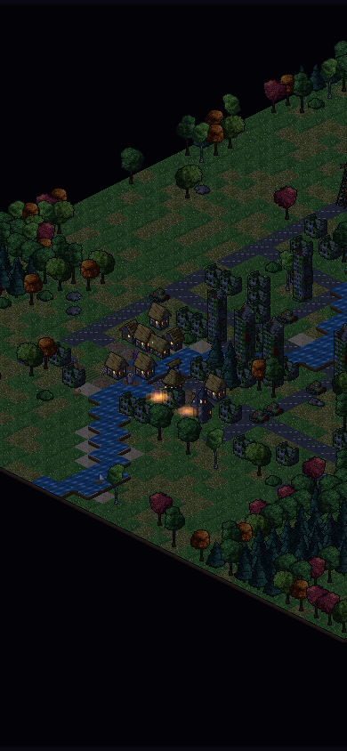
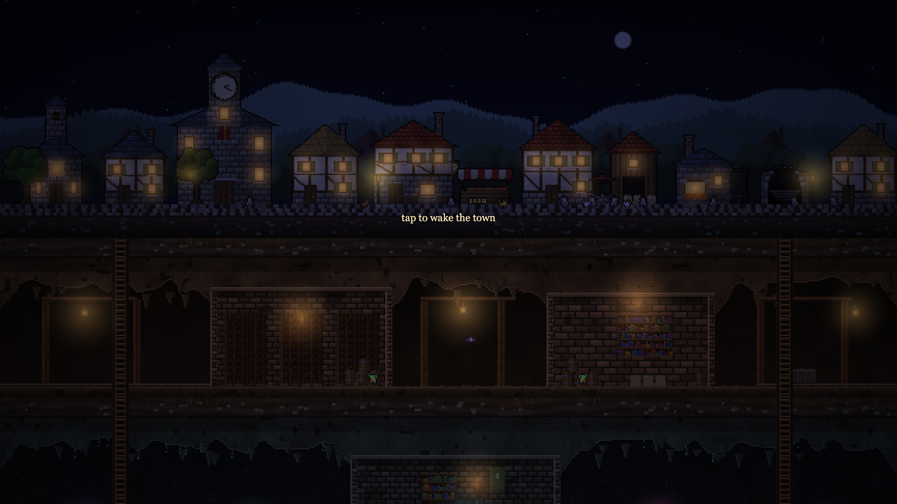
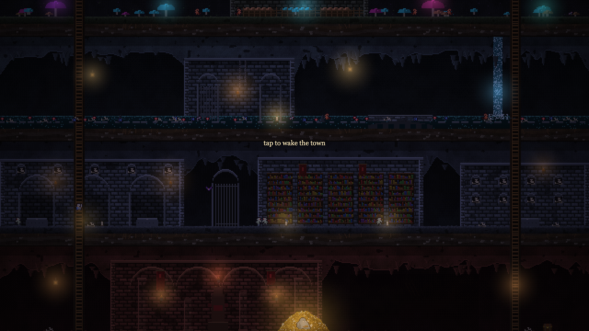
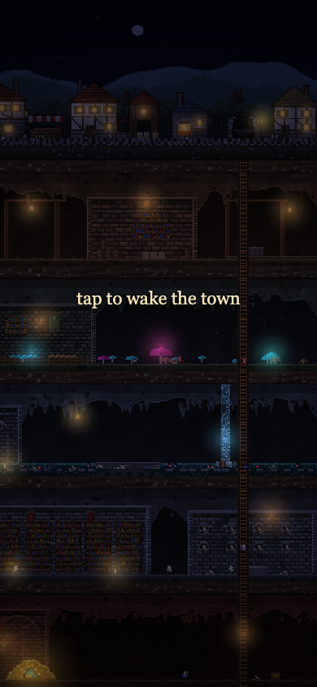

# Round three (r3): results

This round was held on 2026-11-27. Three Opus agents each built one idea, with entries in `<idea>/gauntlet/r3-opus/`, under the new rules: 30 minutes, graphics as PNG sheets in `art/` with a JSON per sheet and `art/index.json`, PSX-level detail, and Opus subagents allowed for the art. They started at **02:00** (Europe/Madrid), so the end time was **02:30**.

The shared server at `http://localhost:8090/` and the look tool, `idletoys/tools/look.sh`, were the same as in round two.

## Notes during the round
- 02:07: the dungeon contestant was stopped by an API error ("Output blocked by content filtering policy") while reading the music generator. Its three art helpers had already finished. The judge resumed it with its context intact at 02:07, with the same 02:30 deadline and a tip not to print the whole lofi script into its output.
- 02:11: resuming failed at once with the same error, so the judge started a fresh Opus contestant in the same folder, keeping the finished art sheets. To make up for the time lost, its deadline is 02:37 instead of 02:30.
- 02:12: drive finished (it says about 02:15) and looked eight times, with errors: 0 each time. An art helper downloaded Natural Earth's roads data at build time to bake the road graph (the brief asks for it); the 50 MB download sits in /tmp, outside the repo.
- 02:14: civilization finished (it says about 02:14) and looked four times, with errors: 0 on the last run. It used one Opus art helper.
- 02:19: dungeon (restarted) finished (it says about 02:22, inside its 02:37 deadline) and looked three times, with errors: 0. It used the first contestant's art sheets unchanged.
- 02:30: the 30-minute deadline passed for civilization and drive, which had both finished. The restarted dungeon had also finished, at about 02:22.

## How they were judged

Each entry was run with the look tool at 390 x 844 and 1920 x 1080 (after 5 s, after 60 s, and after a tap), again with `?hour=13` for day and `?hour=20` for dusk, and once for 5 minutes idle at 1920 x 1080. The round ran at night, so the plain runs show night. The judge's browser is in Spanish. I can't hear the music or test on a real phone, so Music is judged from the code.

## Rule checks

All three pass:

- **Files:** each folder has `index.html`, `art/` with PNG sheets, a JSON per sheet and `art/index.json`, the art scripts in `tools/`, `manifest.webmanifest`, `sw.js`, `icon.svg` and `NOTES.md`.
- **Art:** every page loads its sheets from `art/index.json`, and every `sw.js` caches what that index lists.
- **PWA:** the manifest is linked and the service worker is registered.
- **Network:** the only outside host is `api.open-meteo.com` (dungeon and drive).
- **`innerHTML`:** civilization and dungeon use it for their cards, and every text value goes through `esc()`; the rest are numbers or fixed text. Drive doesn't use it.
- **Stayed in the folder:** nothing outside the three `r3-opus/` folders changed during the round, apart from the judge's own README edit. Drive's road helper downloaded Natural Earth's roads at build time, as its brief asks, into `/tmp`.
- **Console:** 0 errors and 0 warnings in all twelve runs. Round two's "AudioContext was not allowed to start" on the phone tap is gone: all three now start the sound on `click`.

## Scores (1 to 5)

| | Dungeon | Civilization | Drive |
|---|---|---|---|
| Artfulness | 4 | 5 | 5 |
| Polish | 3 | 4 | 4 |
| Idle | 4 | 5 | 5 |
| Steering | 5 | 4 | 4 |
| Music | 4 | 4 | 4 |
| Faithful | 4 | 4 | 5 |
| Room to grow | 4 | 4 | 5 |
| **Total** | **28** | **30** | **32** |

Round two's totals were 27, 28 and 30, so all three went up a little, and each round-three entry is now the best of its toy.

## 1. Drive (32)

This is the closest to its brief of any entry so far. The cockpit is drawn at real PSX-like detail, with gloved hands, two lit dials, an odometer and a radio showing the station ("MESETA FM"). Out of the windscreen there's a dense city of lit windows, lamps and a road barrier. The day run shows a real daytime city with blue sky and glass towers, so the "only night was ever seen" bug is gone. After 5 minutes the camera had moved to the chase view by itself, with a red car under a crescent moon. Underneath, the road graph is baked from Natural Earth (456 nodes, 20 cities), the light follows the real sun, and the weather comes from Open-Meteo. There are test switches for hour, weather, camera and stop, and each sheet has its generator script, which makes it a good base.

What lets it down is the "Toca para encender la radio" ("tap to turn on the radio") pill. It sits in the middle of the windscreen in every run, still there after 5 minutes. The HUD's credits line at the top is tiny. On a phone the cockpit is squeezed into the bottom third under a lot of sky.

## 2. Civilization (30)

This is the richest world of all three rounds. It's an isometric town on a river, surrounded by overgrown ruined towers, rusted cars and pylons, with trees in greens, oranges and reds, so the brief's "every forest repeats one tree" is fixed. By day it's bright and readable. After 5 minutes idle the thatched village had become a brick town with lit windows and road lamps, so an age change shows up without any input. No hint stays stuck on screen, and the first event comes at about 25 seconds.

The ground is still flat single-colour tiles, and the terrain is a sketch of each city rather than its real map, both known bugs from round two. There's no real weather. On a phone the map is drawn off-centre, with its black edge filling the top-left corner and the bottom of the screen.

## 3. Dungeon (28)

The first contestant was stopped twice by an API error. A fresh contestant built this entry from 02:11, using the art sheets the first one's helpers had made. Its floors finally differ, which fixes round two's "every floor repeats the same pattern": glowing mushroom caves, a river grotto with a waterfall, a crypt of skulls, a library, and the hoard with its gold. Its steering is the fullest of the three (horn, drum, a fate nudge, following a being, a chronicle book and a city list), and it has real weather, ages and a collapse that can lose the town for good.

But it's very dark and murky. In the day run the camera had drifted into the deep, so the daytime town was never seen. The street at night is small and dim compared with round two's. The "tap to wake the town" hint sits in the middle of the screen for all 5 minutes, which repeats the "hints stuck" bug. It has no Spanish text.

## What to change next time

- **The API error cost a contestant.** The content filter stopped the first dungeon contestant twice, at the point where it read the Clockscapes music script. Resuming hit the same error, so it had to be restarted from scratch. Tell contestants up front never to print or Read that script, only to cut it out and splice it in with a script.
- **First-tap hints still stick.** Two of three entries left a "tap to..." line in the middle of the screen while idle. The rule should say the hint fades after a few seconds even if nobody taps, and the look tool could flag text that is still visible at 60 s.
- **The camera hid the day scene.** The dungeon's `?hour=13` run showed only the deep. A `?cam=` switch to fix the camera, like drive's, should be asked for in every brief.
- **Phone framing.** Civilization's phone view showed the map edge. The look tool's phone shot did its job here, but a contestant needs to look at that picture as closely as the desktop one.
- **Contestants finish early.** Two finished in about 15 of their 30 minutes. A reminder at the halfway mark to keep polishing would use the time.
