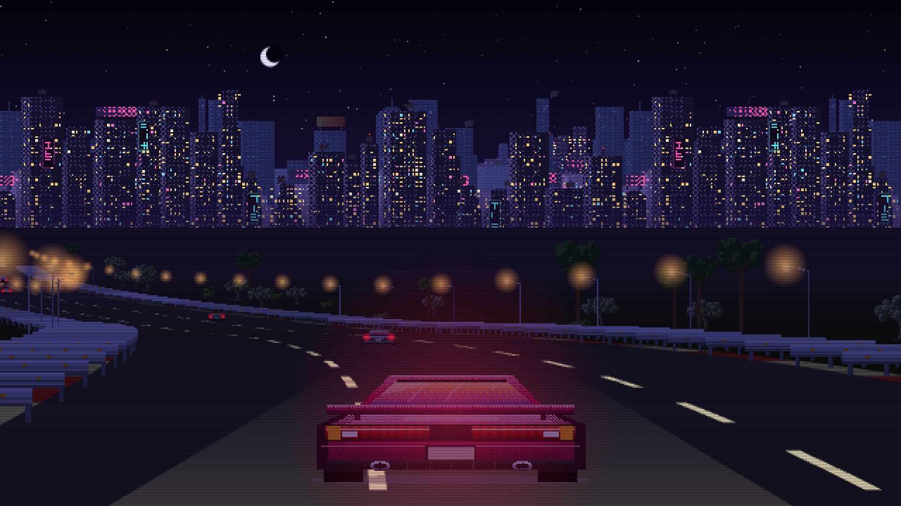
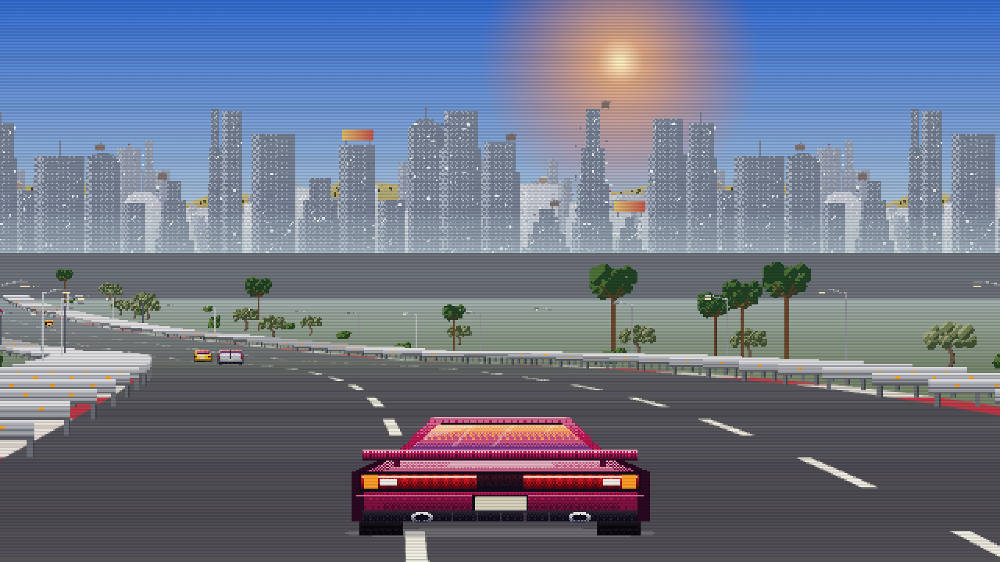
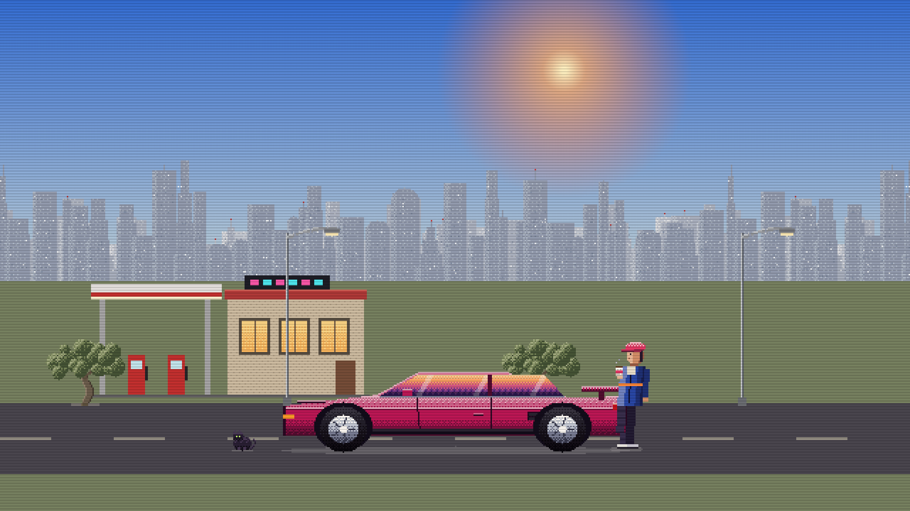
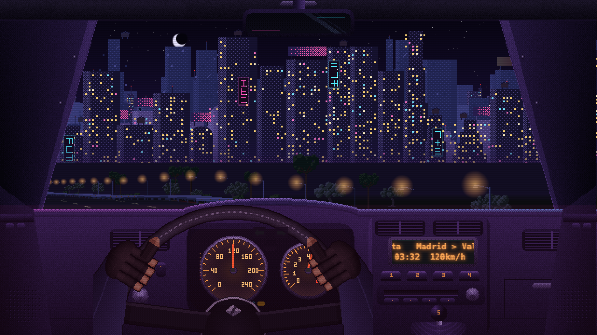
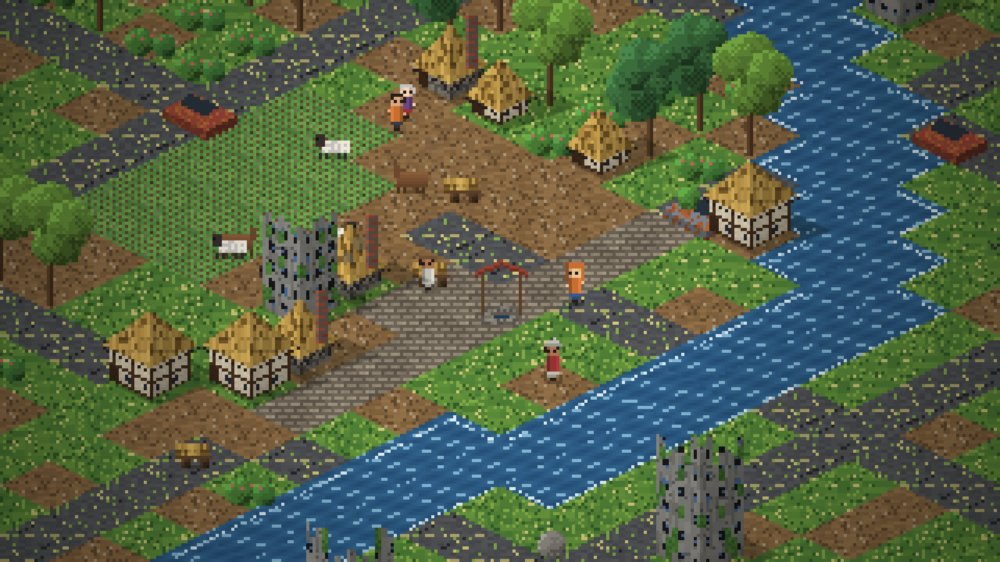
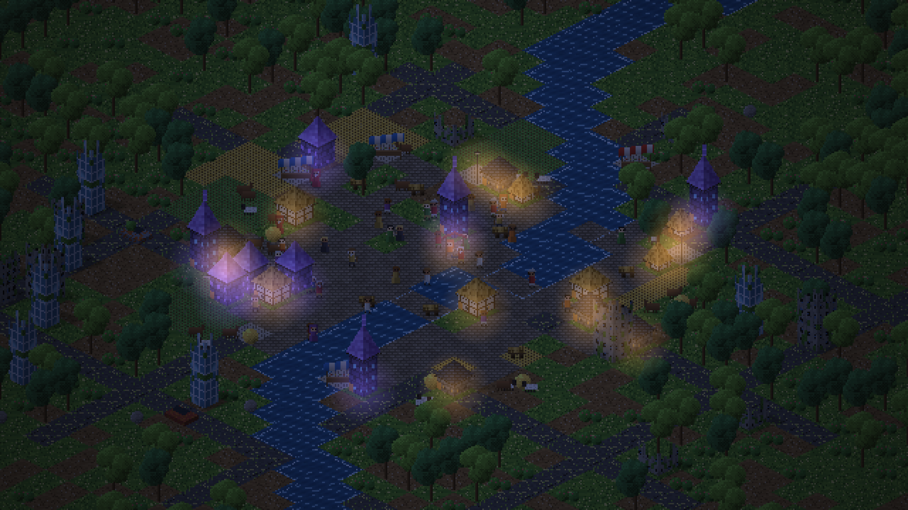
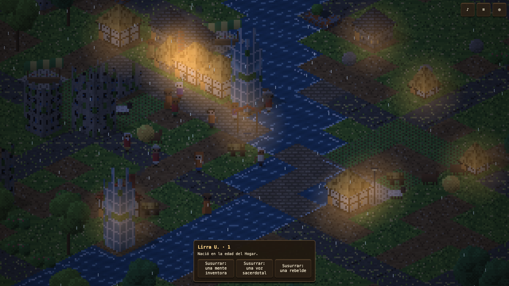
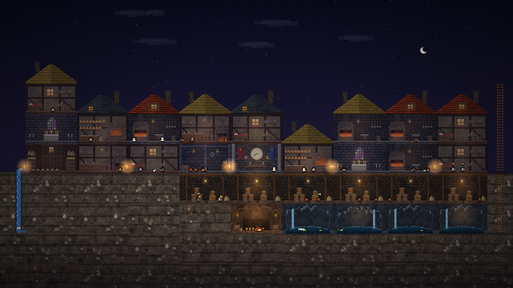
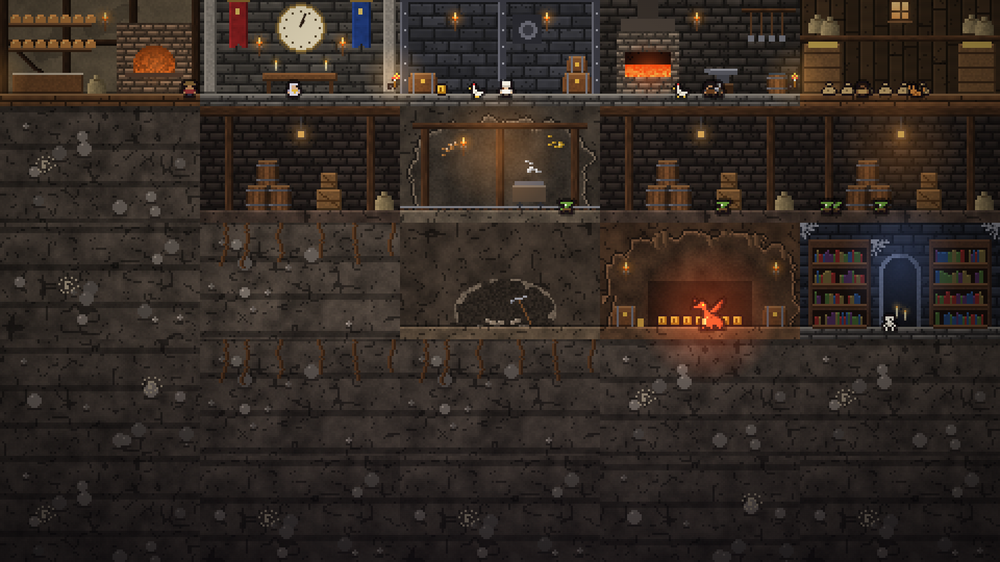
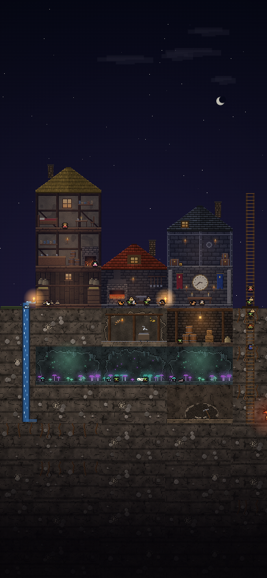

# Round four (r4): results

This round was held on 2026-11-27. Three Opus agents each built one idea, with entries in `<idea>/gauntlet/r4-opus/`. The rules were as in round three, plus three changes: `docs/SYSTEMS.md` (each system with a Mermaid diagram, its numbers and a worked example), use all 30 minutes, and never print the music script. They started at **03:02** (Europe/Madrid). The halfway mark was 03:17 and the end time **03:32**.

The shared server at `http://localhost:8090/` and the look tool, `idletoys/tools/look.sh`, were the same as in rounds two and three.

## Notes during the round
- 03:10: the dungeon contestant was stopped by the same API error as in round three ("Output blocked by content filtering policy"). Its two art helpers had finished (rooms and beings sheets, art/index.json). The judge started a fresh Opus contestant in the same folder at 03:10, keeping the art, with the deadline moved to 03:40 to make up the lost time.
- 03:17: halfway mark. All three contestants were still working, so nobody needed a reminder to keep polishing.
- 03:23: drive handed in nine minutes early (look tool: errors 0 on every run, route tests passing). As the halfway rule intends, the judge sent it back to keep polishing until 03:32.
- 03:23: civilization handed in early (last look 03:23, errors 0 on all five runs). The judge sent it back to keep polishing until 03:32.
- 03:26: dungeon (restarted) handed in at about 03:27, with its deadline at 03:40 (six looks, errors 0). The judge sent it back to keep polishing until 03:40.
- 03:27: drive used part of the extra time (last change 03:27): it checked that the AudioContext reaches running after a tap, fixed the always-lit indicator lamps and the glowing hands at night, and added a traffic jam.
- 03:28: civilization used part of the extra time (stopped 03:28): it lined the ground up with the simulation so nobody stands in the river, added a hint of the coming branch, calmed the camera zoom, and logs 'sound: running' after a tap. Its NOTES.md gives the time as 03:02 to 03:32, though it stopped at 03:28.
- 03:32: time up for civilization and drive (both already final). Dungeon keeps going until 03:40.
- 03:36: dungeon stopped at 03:37. In the extra time it found and fixed a bug from its first hand-in that kept the music from ever playing (it checked window.LOFI, but LOFI is a top-level const). Its last phone look stalled, so the judge's runs are the first full check of the fix.
- 03:40: the dungeon's deadline. It had stopped at 03:37.

## How they were judged

Each entry was run with the look tool at 390 x 844 and 1920 x 1080 (after 5 s, after 60 s, and after a tap), again with `?hour=13` and `?hour=20`, once on each main camera with `?cam=`, and once for 5 minutes idle at 1920 x 1080. The round ran at night, so the plain runs show night. The judge's browser is in Spanish. I can't hear the music or test on a real phone. This round, though, civilization and dungeon log a line when their music starts, so the console shows whether it really plays.

## Rule checks

All three pass:

- **Files:** each folder has `index.html`, `art/` with PNG sheets, a JSON per sheet and `art/index.json`, the art scripts in `tools/`, `manifest.webmanifest`, `sw.js`, `icon.svg`, `NOTES.md` and the new `docs/SYSTEMS.md` (5 Mermaid diagrams in civilization and dungeon, 3 in drive). Drive also has route tests (`tools/route.test.mjs`).
- **Art:** every page loads its sheets from `art/index.json`, and every `sw.js` caches what that index lists.
- **PWA:** the manifest is linked and the service worker is registered.
- **Network:** the only outside host is `api.open-meteo.com` (dungeon and drive).
- **`innerHTML`:** every text value goes through `esc()`. Drive only empties its HUD with it.
- **Stayed in the folder:** nothing outside the three `r4-opus/` folders changed during the round.
- **The docs are true:** I checked two numbers in each `docs/SYSTEMS.md` against the code, and all matched:
  - civilization's whisper gap of 1800 s is `WHISPER_GAP = 30 * 60` (`index.html:3350`);
  - drive's jam, first at 240 s, then every 540 s, lasting 30 s, is `index.html:3287`;
  - dungeon's idle camera glance, every 40 to 70 s for 14 s, is `40 + R() * 30` (`index.html:3575`).
- **Console:** 0 errors in all twenty runs. After the tap, civilization logs `sound: running` and dungeon logs `music: running dungeon 40 bars` at both sizes, so their music really starts. Drive checked the same during the round and then removed its log line.
- **Hints:** no hint was left on screen at 60 s in any entry. That's a first: rounds one and three both had stuck hints.

## Scores (1 to 5)

| | Dungeon | Civilization | Drive |
|---|---|---|---|
| Artfulness | 4 | 5 | 5 |
| Polish | 4 | 4 | 5 |
| Idle | 4 | 5 | 5 |
| Steering | 5 | 5 | 4 |
| Music | 4 | 4 | 4 |
| Faithful | 4 | 4 | 5 |
| Room to grow | 4 | 4 | 5 |
| **Total** | **29** | **31** | **33** |

Round three's totals were 28, 30 and 32, so each toy gained one point and each round-four entry is now its toy's best.

## 1. Drive (33)

The most complete entry of all four rounds:

- **The road:** curves past orange street lamps and palms under a dense lit skyline. By day the sky turns blue with a hazy sun.
- **The stop:** the driver stands with a coffee by a red car at a fuel station, and a black cat sits by the wheel.
- **The cockpit:** after 5 minutes the camera had moved to the cockpit by itself. It has gloved hands on the wheel, lit dials and a radio display reading "Madrid > Val, 03:32, 120 km/h".
- **No stuck hint:** round three's radio pill is gone, and so are the falsely lit indicator lamps.
- **Underneath:** the road graph is baked from Natural Earth and tested, and `docs/SYSTEMS.md` matches the code.

The daytime skyline is a flat grey band, the curves are noise rather than the real road, and there is only one model of car.

## 2. Civilization (31)

The town camera by day is the most charming close-up of all four rounds:

- **The town:** half-timbered houses with thatched roofs, a well, a ploughed field with sheep, people in coloured clothes, and a ruined tower wrapped in vines by the river.
- **Ages:** in 5 minutes of idling the town took the arcane branch, and violet spires rose among the lit houses, so the age change shows by itself.
- **Whispers:** the look tool's tap in the middle landed on a person and opened their whisper card, with three choices. That proves the feature on screen.
- **Ground:** this round the ground has texture and the fields are ploughed, which fixes round two's flat tiles.

At night the house glows are drawn as soft squares, which the agent admits. The places are hints rather than real maps, there's no real weather, and it has no simulation tests. On a phone the view is very close and dark.

## 3. Dungeon (29)

The first contestant was stopped again by the API error. A fresh one took over at 03:10 with its art.

- **The scene:** a new idea that suits the brief's "start small, grow room by room". A row of cut-open houses shows every room: beds, a forge, shelves of bread, a town hall clock. The dungeon is dug one cave at a time beneath them.
- **The deep camera:** shows the dragon asleep in a lit cave beside a library and the storerooms.
- **Growth:** between 60 s and 5 minutes the town changed, with new floors and roofs.
- **Steering:** the fullest of the three (horn, drum, fate, chronicle, city, following a being, a grave hill).
- **Its music works:** but only thanks to the extra time. The first hand-in never played any.

The lower half of the screen is mostly bare rock while the dungeon is young, so the first minutes feel top-heavy. The beings are still very small on a desktop, and the day sky is a dull grey.

## What to change next time

- **The dungeon brief keeps setting off the API filter.** For the second round running, the dungeon contestant was stopped by "Output blocked by content filtering policy" in its first ten minutes, and only the dungeon. The music script is ruled out this time, because the rule against printing it was already in force. Something in the dungeon brief or its bestiary is the likely cause. Try a dungeon-only run that reads the brief section by section, to find the part that sets it off.
- **Everyone still handed in early.** All three stopped 5 to 13 minutes before time despite the new rule. The halfway reminder worked: each went back and fixed real problems, including the dungeon's silent music. Consider making the reminder part of the prompt ("at 15 minutes, re-read the brief's checklist and keep going").
- **Sound can now be checked.** Two entries log a line when the music starts. Make that a rule (for example `?debug=1` logs "music: running"), and have the look tool print it in its summary.
- **The look tool hung once** on the dungeon contestant's phone run, on a busy machine. Give it a time limit per size, so a stuck run fails clearly instead of waiting.
